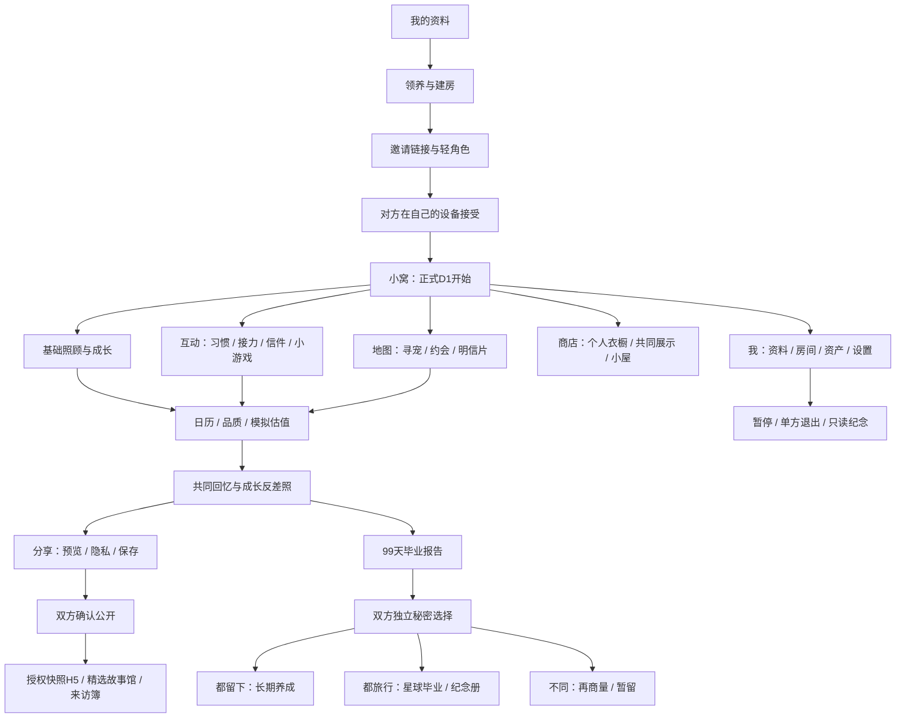

# Jagat 99天养宠计划 · 原型模型 v1

2026-10-21。供产品布局和交互评审，不是新增玩法的线上发布。

## 如何查看

- 双击 `public/game-prototype.html`，用浏览器打开即可。单文件离线运行，无外部素材与远程字体依赖。
- 也可 `npm run dev` 后打开 `/game-prototype.html`。完整生产构建会包含该静态文件；本次未推送或触发部署，现有公网网址不会自动出现此原型。
- 顶部依次查看：功能脑图、可点击手机原型、六条核心流程、现状对照清单、优化与待定规则。
- 点击脑图节点打开对应手机页面；页面左侧切换场景，手机内滚动并点击按钮，右侧查看当前实现、目标布局、权限与异常说明。
- 表单和结果仅为评审演示；没有A/B玩家切换，不连接真实房间、不保存私人正文、不发生扣费或外部发布。刷新重置示例状态。
- 页面数为35个“页面/交互场景”，不等同于现有独立路由数。当前代码共14个页面组件。

## 当前结构与目标结构

当前手机导航：小窝 / 地图 / 互动 / 商店 / 我。保留这五个入口。

当前二级入口：个人页进入房间、换装、小屋或更多；更多聚合估值、日历、奖励、剧情、分享和毕业。日记分散在日历、寻宠、约会等页面。

目标：小窝突出一个待回应事件；互动聚合共同习惯与接力；我按房间、资产、成长、设置分组；日记整合为共同回忆。地图加入明信片，成长加入阶段外观快照。详见原型“现状对照清单”。

## 设计方向与需要确认的差异

- 共同习惯：有限可组合模板，两位分别选择，双方提交后形成有趣习惯；复用性格、日记和分享。
- 接力：非同时在线的共同事件；到期不扣永久成长与羁绊。48小时等参数仅为试验起点。
- 成长反差：保存领养与D21/49/77快照；D30成长报告和D99纪念继续保留。
- 明信片：虚拟地图地点和可选寄语，伙伴主动打开后入回忆。不采集真实地址。
- 轻角色：称号用于邀请和首次反馈，不限制操作权限，不按分工考勤。
- 宽限徽章：允许缺席，不抹除自然日进度和永久记忆。文档建议不覆盖当前喂养/品质公式。
- 捏脸：原创SVG部件和配色，免费路径可用；会员次数和价格未定，不接真实AI生成。
- 个人衣橱：目标是购买者持有、共同宠物展示；当前共享背包必须设计历史物品迁移，不能随意分配归属。
- 暂停/托管：目标是退出撤权与只读纪念。现有解除会清除私人信与未揭晓票，不等同于新托管。
- 公开故事：先编辑和双方确认，再人工选稿，授权快照可撤回未来展示；不承诺删除他人已下载图片。
- 来访簿：站外轻反馈，不能改宠物或资产，也不计Jagat DAU。
- 99天是篇章：保留三种秘密结局，保留继续养成路径，不将选择与基金绑定。
- 单人正式领养：收录为后续可选路线；当前默认仍为受邀人接受后开启正式周期，未绑定可做无奖励试玩。尚未改变之前规则。
- Jagat接入：当前公网演示保持独立；未来站内养宠与站外授权故事H5分开，账号、深链、路由和支付需实际联调。
- 真实现金双选、交易市场、分手评理社区、实体履约、运行时自由AI不纳入首轮交互原型的可执行功能，保留为远期评估。当前游戏仍模拟支付/广告/基金。

## 评审产物

- `artifacts/功能脑图.png`：整体功能分组。
- `artifacts/Jagat-功能脑图.pdf`：适合放大浏览或打印。
- `artifacts/手机原型与页面说明.png`：手机布局与右侧交互说明。
- `artifacts/小窝手机画面.png`：手机画面示例。
- `artifacts/Jagat-关键交互流程.pdf`：六条主要流程与三种终局。
- `页面清单.md`：35场景的现有能力、布局和规则。

## 验证

原型JavaScript语法检查；Chromium逐页打开35场景；喂食和模拟购买防重；PNG实际下载；三种结局弹窗；地图缩放及地点导航；375/390/430px视图无页面横向溢出；无未捕获页面脚本错误。检查仅适用于设计原型，不代表新增功能的业务服务已实现。

资料依据：仓库`src/main.tsx`与`src/pages/*`；此前V3设计；用户提供BRD/MRD v1.2第16—24页和28页。文档ROI、价格、窗口数值和增长效果不视为已验证事实。
